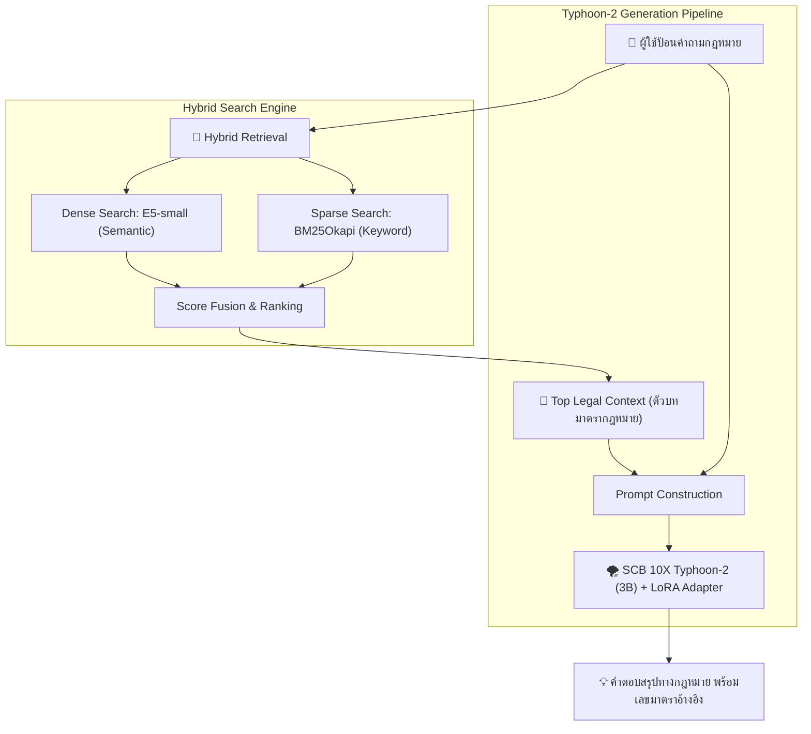

# 📚 Thai Legal RAG Chatbot (Powered by Typhoon-2)


แชทบอทตอบคำถามกฎหมายไทยด้วยสถาปัตยกรรม **Hybrid RAG** (Dense Retrieval + BM25) ผสานพลังกับ **SCB 10X Typhoon-2 (3B)** ที่ผ่านการ Fine-tune ด้วย LoRA โดยเฉพาะ เพื่อการสรุปความกฎหมายที่แม่นยำและอ้างอิงเลขมาตราได้ถูกต้องตรงตามตัวบท

> 🔗 **LoRA Adapter Checkpoint:** [DuckerMaster/thai-legal-lora (HuggingFace)](https://huggingface.co/DuckerMaster/thai-legal-lora)  
> 💻 **GitHub Repository:** [PlamGG/thai-legal-rag](https://github.com/PlamGG/thai-legal-rag)

---

## 📊 ประสิทธิภาพและการประเมินผล (A/B Benchmark Results)

ประเมินเปรียบเทียบแบบหมัดต่อหมัด (A/B Testing) บนคำถามกฎหมายสุ่มจาก Test Set ของ **WangchanX-Legal-ThaiCCL-RAG** จำนวน 50 ตัวอย่าง (รันบน Kaggle GPU T4):

| Metric | Base Typhoon-2 (3B) | 🌪️ Typhoon-2 + LoRA (Ours) | Delta (การพัฒนา) |
| :--- | :---: | :---: | :---: |
| **ROUGE-L (avg)** | 8.11% | **25.38%** | **+17.27%** *(โตขึ้น 3.1 เท่า)* |
| **Section Match Rate** | 34.00% (17/50) | **62.00%** (31/50) | **+28.00%** *(ตรงมาตราเพิ่มขึ้น)* |
| **Inference VRAM** | ~3.5 GB | ~3.5 GB | คงที่ (NF4 4-bit) |
| **Inference Speed** | ~1.8s/คำถาม | ~1.9s/คำถาม | ใกล้เคียงเดิม |

> 💡 **การวิเคราะห์ผล:** โมเดล Base ปกติมักตอบแบบกว้างๆ หรือทวนคำถาม แต่เมื่อประกอบกับ LoRA Adapter โมเดลสามารถดึงตัวบทมาตรากฎหมายจากบริบท (Context) มาเรียบเรียงเป็นคำตอบภาษาไทยที่กระชับและตรงจุดมากขึ้นอย่างมีนัยสำคัญ

---

## 🎯 สถาปัตยกรรมระบบ (System Architecture)



---

## 📦 ที่มาของชุดข้อมูล (Dataset Source)

- **Dataset:** [WangchanX-Legal-ThaiCCL-RAG](https://huggingface.co/datasets/airesearch/WangchanX-Legal-ThaiCCL-RAG) (VISTEC-depa / AIResearch Thailand)
- **ขอบเขตกฎหมาย:** กฎหมายแพ่งและพาณิชย์ไทย (Thai Corporate & Commercial Law — ThaiCCL)
- **Corpus การค้นหา:** สกัดเฉพาะตัวบทกฎหมายที่ไม่ซ้ำกัน 4,545 มาตรา
- **การฝึกสอน:** คู่คำถาม-คำตอบกฎหมายธุรกิจ เพื่อปรับจูนสไตล์การตอบแบบสรุปประเด็น

---

## 🚀 การติดตั้งและเริ่มใช้งาน (Quick Start)

### 1. ติดตั้ง Dependencies
```bash
pip install -r requirements.txt
```

### 2. รันแชทบอทผ่าน Web UI (Gradio)
```bash
python rag_gui.py
```
เปิดเบราว์เซอร์ไปที่ `http://127.0.0.1:7860`

---

## 🛠️ Full Pipeline Setup (สำหรับรันเองตั้งแต่ต้น)

1. **เตรียมข้อมูลมาตรากฎหมาย:**
   ```bash
   python data_preparation.py
   ```
2. **สร้าง Index การค้นหา (Vector + BM25):**
   ```bash
   python build_index.py
   ```
3. **Fine-tune LoRA ด้วยโมเดล Typhoon-2:**
   ```bash
   python finetune_generator.py
   ```
4. **รันการประเมินผล A/B Test (Kaggle / Local):**
   - อัปโหลดและรันไฟล์ [kaggle_evaluation.ipynb](kaggle_evaluation.ipynb) บน Kaggle (GPU T4)

---

## 📝 รูปแบบ Prompt ที่ถูกต้องสำหรับ LoRA โมเดลนี้

เพื่อให้โมเดลตอบได้แม่นยำที่สุดตามที่ถูกฝึกมา ควรใช้ Prompt Format ดังนี้:

```text
จากกฎหมายต่อไปนี้:
{context}

คำถาม: {question}
คำตอบ:
```

---

## 📁 โครงสร้างโปรเจกต์ (Project Structure)

```text
├── data/
│   ├── passages.pkl            # คลังตัวบทมาตรากฎหมาย (Corpus)
│   ├── chroma_db/              # ChromaDB Vector Store
│   └── trained_lora_model/     # LoRA Adapter Weights (Typhoon-2)
├── build_index.py              # สคริปต์สร้างดัชนี E5 และ BM25
├── data_preparation.py         # สกัดและทำความสะอาดชุดข้อมูล
├── finetune_generator.py       # สคริปต์ฝึกสอน LoRA
├── kaggle_evaluation.ipynb     # Notebook วัดผล A/B Benchmark บน Kaggle
├── rag_gui.py                  # หน้าต่าง Web UI (Gradio)
├── rag_inference.py            # Core Pipeline สำหรับสืบค้นและตอบคำถาม
└── requirements.txt            # รายการ Dependencies
```

---

## 📄 License

MIT License — โปรเจกต์นี้จัดทำขึ้นเพื่อการศึกษาและการวิจัยเชิงเทคนิค คำตอบที่ได้จากระบบไม่สามารถใช้แทนคำปรึกษาทางกฎหมายจากทนายความหรือผู้ประกอบวิชาชีพกฎหมายได้
