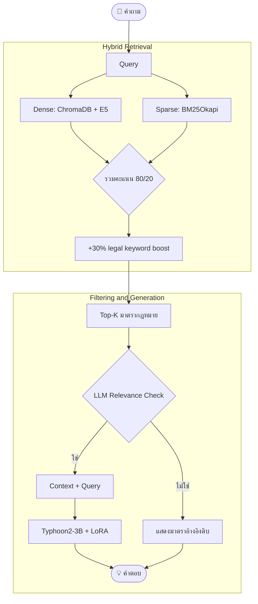

# 📚 Thai Legal RAG Chatbot


แชทบอทตอบคำถามกฎหมายไทยด้วย **Hybrid RAG** (Dense + BM25) ร่วมกับ LLM ที่ Fine-tune เฉพาะทาง เพื่อการตอบคำถามกฎหมายที่รวดเร็วและอ้างอิงมาตราได้ถูกต้อง

> 🔗 **โมเดลสำเร็จรูป:** [DuckerMaster/thai-legal-lora (HuggingFace)](https://huggingface.co/DuckerMaster/thai-legal-lora)


---

## 🙋 อธิบายง่ายๆ สำหรับคนไม่รู้เรื่องเทคนิค

**นี่คืออะไร:** โปรแกรมที่พิมพ์คำถามกฎหมายไทยเข้าไป แล้วมันจะหาว่ากฎหมายมาตราไหนเกี่ยวข้อง จากนั้นสรุปคำตอบเป็นภาษาไทยอ่านง่ายให้เรา

**เปรียบเทียบง่ายๆ:** เหมือนมีบรรณารักษ์กฎหมาย (1) ค้นหนังสือกฎหมายทั้งเล่มให้ไวมาก (2) หยิบหน้าที่เกี่ยวข้องที่สุดมาวางบนโต๊ะ (3) อ่านสรุปให้ฟังเป็นคำพูดปกติ แทนที่เราต้องไปงมอ่านตัวบทเอง

**ใช้ยังไง:** รันคำสั่งเดียว (`python rag_gui.py`) → เปิดหน้าเว็บ → พิมพ์คำถาม → รอ 2-3 วินาที → ได้คำตอบ ไม่ต้องเข้าใจ AI หรือโค้ดเลยก็ใช้ได้

---

## 📊 ผลลัพธ์และประสิทธิภาพของระบบ (System Performance & Metrics)

ประเมินด้วย Test Set จาก **WangchanX-Legal-ThaiCCL-RAG** จำนวน 100 ตัวอย่าง (สุ่มจาก Test split 3,742 รายการ)

> ⚠️ **Preliminary Evaluation (n=100):** ผลลัพธ์ด้านล่างเป็นการประเมินเบื้องต้น ขนาด sample ยังไม่เพียงพอสำหรับ statistical significance เต็มรูปแบบ ควรใช้เป็นแนวทางเปรียบเทียบ ไม่ใช่ตัวเลขสุดท้ายสำหรับ production decision

### Retrieval
| Metric | ค่า |
| :--- | :--- |
| Recall@1 | **68.00%** |
| Recall@3 | **78.00%** |
| ความเร็วค้นหาเฉลี่ย | 43.89 ms/คำถาม (GPU) |

### Generation (n=20, preliminary)
| Metric | ค่า | หมายเหตุ |
| :--- | :--- | :--- |
| **Hallucination Rate** | **0.00%** (0/20) | ✅ ไม่มั่วมาตราที่ไม่มีในบริบทเลย |
| Section Match Rate | 10.00% (2/20) | อ้างมาตราตรงกับ ground truth |
| ROUGE-L (avg) | 1.97% | ต่ำเพราะระบบเลือก "ปฏิเสธตอบ" แทน "ตอบผิด" — ดูคำอธิบายด้านล่าง |
| ความเร็วตอบ (end-to-end) | ~28.8s/คำถาม | รวม relevance check + generation |
| VRAM Usage (Inference) | 4–6 GB | NF4 4-bit, Typhoon2-3B |

> ✅ **จุดเด่น: Zero Hallucination.** ระบบตั้งเกณฑ์ปฏิเสธการตอบเมื่อ retrieval score < 0.5 หรือ LLM relevance check ตัดสินว่าบริบทไม่เกี่ยวข้อง แทนที่จะเดาคำตอบ — เป็นการออกแบบเชิง Conservative ที่แลก coverage (ROUGE-L/Section Match ต่ำเพราะหลายข้อเลือกไม่ตอบ) เพื่อความปลอดภัยของคำตอบ (Hallucination 0%) ซึ่งเหมาะกับ use case กฎหมายที่ต้นทุนของ "คำตอบผิด" สูงกว่า "ไม่ตอบ" มาก
>
> **Next Steps:** ขยาย test set ให้ใหญ่ขึ้น และปรับ relevance threshold เพื่อเพิ่ม coverage โดยยังคง Hallucination Rate ต่ำ

---

## 📌 สารบัญ
1. [ที่มาของข้อมูล](#-ที่มาของข้อมูล-data-source)
2. [Quick Start](#-quick-start)
3. [Full Pipeline Setup](#️-full-pipeline-setup)
4. [สถาปัตยกรรม](#-สถาปัตยกรรม)
5. [Troubleshooting](#-troubleshooting)
6. [โครงสร้างโปรเจกต์](#-โครงสร้างโปรเจกต์)

---

## 📦 ที่มาของข้อมูล (Data Source)

| รายการ | รายละเอียด |
| :--- | :--- |
| **ชื่อ Dataset** | [WangchanX-Legal-ThaiCCL-RAG](https://huggingface.co/datasets/airesearch/WangchanX-Legal-ThaiCCL-RAG) |
| **ผู้สร้าง** | [VISTEC-depa AI Research Institute of Thailand (AIResearch)](https://huggingface.co/airesearch) |
| **ขอบเขตกฎหมาย** | กฎหมายแพ่งและพาณิชย์ไทย (Thai Corporate & Commercial Law — ThaiCCL) |
| **รูปแบบข้อมูล** | คู่ Question ↔ Positive Context (มาตรากฎหมายที่ตอบคำถาม) พร้อม Hard Negatives |
| **จำนวนข้อมูลดิบ** | 11,953 รายการ (Train: 8,211 / Test: 3,742) |
| **License** | MIT |
| **Technical Report** | [arXiv:2502.10868](https://arxiv.org/abs/2502.10868) |

**โปรเจกต์นี้ใช้ข้อมูลอย่างไร:**
- **Retrieval Corpus:** สกัดเฉพาะ `positive_contexts` ที่ไม่ซ้ำกัน (deduplicated by `unique_key`) มาเป็นคลังมาตรากฎหมายสำหรับค้นหา
- **Fine-tuning Data:** ใช้คู่ Question–Answer จาก Train split เป็นชุดฝึกสอน LLM ให้ตอบคำถามกฎหมาย
- **Evaluation:** ใช้ Test split (100 ตัวอย่าง) วัดค่า Recall@1, Recall@3 และความเร็วค้นหา

---

## 🚀 Quick Start

ทดลองใช้ทันทีโดยดึงโมเดลสำเร็จรูปจาก Hugging Face:

```bash
pip install -r requirements.txt
python rag_gui.py
```

เปิด `http://127.0.0.1:7860` เพื่อเริ่มถามคำถาม

**Dependencies หลัก:** `transformers`, `peft`, `bitsandbytes`, `chromadb`, `rank-bm25`, `gradio`

---

## 🛠️ Full Pipeline Setup

รันตามลำดับหากต้องการประมวลผลข้อมูลใหม่หรือเทรนโมเดลเอง

### 1️⃣ Data Preparation
```bash
python data_preparation.py
```
**วัตถุประสงค์:** เตรียมคลังข้อความกฎหมาย (Legal Corpus) ที่สะอาดและมีคุณภาพ สำหรับใช้เป็นฐานความรู้ในขั้นตอน Retrieval

**ขั้นตอนการดำเนินการ:**
1. **โหลดข้อมูล (Data Loading):** ดึงข้อมูลจาก dataset [WangchanX-Legal-ThaiCCL-RAG](https://huggingface.co/datasets/airesearch/WangchanX-Legal-ThaiCCL-RAG) ด้วยโหมด Streaming เพื่อลดการใช้หน่วยความจำขณะโหลด
2. **คัดกรองข้อมูล (Filtering):** คัดเลือกเฉพาะรายการที่มี Positive Context (บริบทกฎหมายที่เกี่ยวข้องกับคำถามจริง) ตัดรายการที่เป็น Negative/Noise ออก
3. **กำจัดข้อมูลซ้ำ (Deduplication):** ตรวจสอบและลบข้อความมาตรากฎหมายที่ซ้ำกันในชุดข้อมูล เพื่อป้องกัน bias จากการปรากฏซ้ำของบางมาตรา
4. **สกัด Metadata:** แยกเก็บข้อมูลประกอบ เช่น หมวดหมู่กฎหมาย เลขมาตรา เพื่อใช้ในการอ้างอิงภายหลัง

**ผลลัพธ์ (Output):** ไฟล์ `data/passages.pkl` — คลังข้อความกฎหมายที่ผ่านการทำความสะอาดแล้ว พร้อมใช้ในขั้นตอนสร้าง Vector Index (เวลาดำเนินการ ~5 นาที)

---

### 2️⃣ Build Vector Index
```bash
python build_index.py
```
**วัตถุประสงค์:** แปลงข้อความกฎหมายให้อยู่ในรูปแบบเวกเตอร์เชิงความหมาย (Semantic Embedding) เพื่อรองรับการค้นหาแบบ Dense Retrieval

**ขั้นตอนการดำเนินการ:**
1. **แบ่งข้อมูลเป็น Batch:** จัดกลุ่มข้อความจาก `passages.pkl` เป็นชุดย่อยเพื่อประมวลผลอย่างมีประสิทธิภาพ
2. **สร้าง Embedding:** ป้อนข้อความแต่ละ batch เข้าโมเดล `intfloat/multilingual-e5-small` เพื่อคำนวณเวกเตอร์เชิงความหมาย
3. **จัดเก็บดัชนี (Indexing):** บันทึกเวกเตอร์ทั้งหมดลงฐานข้อมูล ChromaDB แบบ Persistent Client เพื่อให้สามารถค้นหาซ้ำได้โดยไม่ต้องคำนวณใหม่

**ผลลัพธ์ (Output):** ฐานข้อมูลเวกเตอร์ `data/chroma_db/` พร้อมใช้สำหรับการค้นหาเชิงความหมาย (เวลาดำเนินการ ~10–15 นาที แนะนำให้ใช้ GPU)

---

### 3️⃣ Fine-tuning LLM
```bash
python finetune_generator.py
```
**วัตถุประสงค์:** ปรับจูนโมเดลภาษาให้สามารถเรียบเรียงคำตอบกฎหมายไทยได้อย่างถูกต้องตามโครงสร้างและยึดโยงกับบริบทที่ป้อนให้

**ขั้นตอนการดำเนินการ:**
1. **Quantization:** ลดขนาดโมเดลฐาน `scb10x/llama3.2-typhoon2-3b` ด้วยเทคนิค 4-bit NF4 เพื่อลดการใช้ VRAM
2. **ติดตั้ง LoRA Adapter:** เพิ่มโมดูล LoRA เข้าที่ target modules `q_proj`, `v_proj`, `o_proj` ของโมเดล เพื่อฝึกเฉพาะพารามิเตอร์ส่วนน้อยแทนการเทรนทั้งโมเดล
3. **ฝึกโมเดล (Training):** เทรนด้วยชุดคำถาม-คำตอบกฎหมายไทย เป็นจำนวน 2 epochs ที่ Learning Rate `2e-4`
4. **บันทึกน้ำหนัก (Save Weights):** เก็บเฉพาะน้ำหนัก LoRA ที่ปรับจูนแล้ว (ไม่ใช่โมเดลเต็ม) เพื่อประหยัดพื้นที่จัดเก็บ

**ผลลัพธ์ (Output):** โมเดล LoRA ในโฟลเดอร์ `data/trained_lora_model/` (เวลาดำเนินการ ~1–2 ชั่วโมง, ต้องมี VRAM ≥ 8GB)

---

### 4️⃣ Local Inference (CLI)
```bash
python rag_inference.py
```
**วัตถุประสงค์:** ทดสอบการทำงานของระบบ RAG แบบครบวงจรในสภาพแวดล้อมออฟไลน์ ก่อนนำไป deploy

**ขั้นตอนการดำเนินการ:**
1. **รับคำถาม:** ผู้ใช้ป้อนคำถามผ่าน CLI
2. **Hybrid Search:** ค้นหาบริบทกฎหมายด้วยคะแนนรวมจาก Dense Search (E5 embedding) 80% และ Sparse Search (BM25Okapi) 20%
3. **Keyword Boosting:** เพิ่มคะแนนให้กับผลลัพธ์ที่มี legal keyword ตรงกับคำถามอีก 30%
4. **Relevance Filtering:** ให้ LLM ตรวจสอบว่าเอกสารที่คัดมาเกี่ยวข้องกับคำถามจริงหรือไม่ ก่อนนำไปใช้สร้างคำตอบ
5. **Generation:** ประกอบ Prompt จากบริบทที่ผ่านการกรองแล้ว ส่งให้โมเดล Typhoon2-3B + LoRA เรียบเรียงคำตอบ

**ผลลัพธ์ (Output):** อินเทอร์เฟซ CLI สำหรับโต้ตอบแบบเรียลไทม์ (~2–3 วินาที/คำถาม)

---

## 🧠 สถาปัตยกรรม



---

## 🔧 Troubleshooting

| ปัญหา | สาเหตุ | วิธีแก้ |
| :--- | :--- | :--- |
| OOM ระหว่าง fine-tune | VRAM ไม่พอ | ตั้ง `batch_size=1`, เพิ่ม `accumulation_steps=8-16` |
| GPU unavailable / รันช้า | CUDA ไม่ทำงาน | รัน `python cuda.py` เช็คเวอร์ชัน PyTorch/CUDA |
| ChromaDB error | numpy/sqlite3 ไม่ compatible | `pip install numpy==1.26.4` หรือ reinstall chromadb |

---

## 📁 โครงสร้างโปรเจกต์

```text
legal-rag-chatbot/
├── data/
│   ├── passages.pkl
│   ├── chroma_db/
│   └── trained_lora_model/
├── data_preparation.py     # [1] เตรียมข้อมูล
├── build_index.py          # [2] สร้าง vector index
├── finetune_generator.py   # [3] fine-tune LoRA
├── rag_inference.py        # [4] CLI chatbot (local model)
├── rag_gui.py               # Web UI (HF model)
├── requirements.txt
└── cuda.py                  # เช็ค CUDA
```

---
