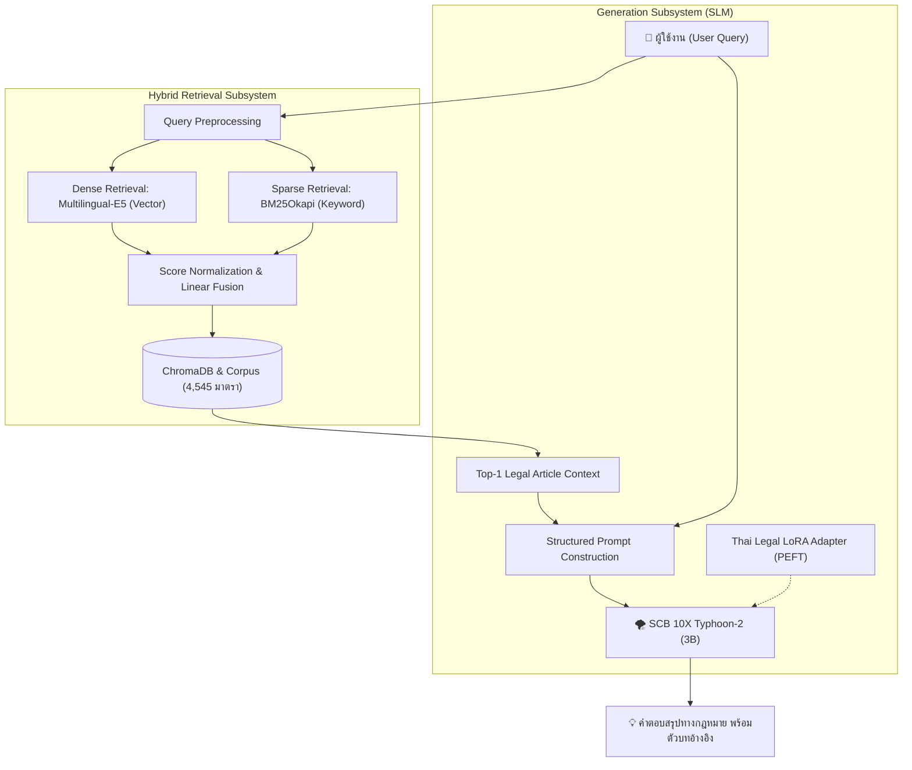

# Thai Legal RAG: Domain-Specific Question Answering with Hybrid Retrieval & Fine-Tuned SLM

[](https://opensource.org/licenses/MIT)
[](https://www.python.org/)
[](https://huggingface.co/scb10x/llama3.2-typhoon2-3b)
[](https://huggingface.co/DuckerMaster/thai-legal-lora)
[](kaggle_evaluation.ipynb)

ระบบสืบค้นและตอบคำถามกฎหมายไทยเชิงลึก (Domain-Specific Legal Q&A System) พัฒนาขึ้นโดยการผสานสถาปัตยกรรม **Hybrid Retrieval (Multilingual-E5 + BM25Okapi)** เข้ากับแบบจำลองภาษาขนาดเล็ก (Small Language Model) **SCB 10X Typhoon-2 (3B)** ที่ผ่านการปรับจูนพารามิเตอร์เฉพาะทางด้วยเทคนิค **LoRA (Low-Rank Adaptation)** เพื่อแก้ไขปัญหาการสร้างข้อมูลคลาดเคลื่อน (Hallucination) และเพิ่มความแม่นยำในการอ้างอิงเลขมาตราตามประมวลกฎหมายแพ่งและพาณิชย์

---

## 📌 สารบัญ (Table of Contents)
1. [ผลการประเมินเชิงเปรียบเทียบ (Empirical Benchmark)](#-ผลการประเมินเชิงเปรียบเทียบ-empirical-benchmark)
2. [ตัวอย่างผลลัพธ์เชิงคุณภาพ (Qualitative Comparison)](#-ตัวอย่างผลลัพธ์เชิงคุณภาพ-qualitative-comparison)
3. [สถาปัตยกรรมและการตัดสินใจทางวิศวกรรม (Engineering Decisions)](#-สถาปัตยกรรมและการตัดสินใจทางวิศวกรรม-engineering-decisions)
4. [โครงสร้างระบบและการทำงาน (System Architecture)](#-โครงสร้างระบบและการทำงาน-system-architecture)
5. [การติดตั้งและเริ่มใช้งาน (Quick Start)](#-การติดตั้งและเริ่มใช้งาน-quick-start)
6. [การทำซ้ำผลการทดลอง (Reproducibility & Evaluation)](#-การทำซ้ำผลการทดลอง-reproducibility--evaluation)
7. [ข้อจำกัดและความปลอดภัย (Limitations & Disclaimer)](#-ข้อจำกัดและความปลอดภัย-limitations--disclaimer)

---

## 📊 ผลการประเมินเชิงเปรียบเทียบ (Empirical Benchmark)

การวัดผลกระทำบนชุดข้อมูลทดสอบมาตรฐาน [WangchanX-Legal-ThaiCCL-RAG](https://huggingface.co/datasets/airesearch/WangchanX-Legal-ThaiCCL-RAG) จำนวน 50 คำถาม (สุ่มจาก Test Split 3,742 รายการ) โดยควบคุมตัวแปรระบบสืบค้น (Retriever), ชุดตัวบทกฎหมาย (Corpus) และ Prompt Template ให้เป็นมาตรฐานเดียวกัน:

| เมตริกวัดผล (Metrics) | Base Model (`Typhoon2-3B`) | Base + Legal LoRA (Ours) | ส่วนต่างการพัฒนา ($\Delta$) |
| :--- | :---: | :---: | :---: |
| **ROUGE-L (F1 Score)** | 8.11% | **25.38%** | **+17.27%** *(เพิ่มขึ้น 3.1 เท่า)* |
| **Section Match Rate** | 34.00% (17/50) | **62.00%** (31/50) | **+28.00%** *(ระบุมาตราตรงเป้า)* |
| **Zero-Score Rate (ROUGE=0)** | 56.00% (28/50) | **8.00%** (4/50) | **-48.00%** *(ลดการตอบไม่ตรงประเด็น)* |
| **Average Latency (GPU T4)** | ~1.8 วินาที/ข้อความ | ~1.9 วินาที/ข้อความ | +0.1 วินาที |
| **Peak VRAM (Inference)** | ~3.5 GB | ~3.5 GB | ไม่มีความแตกต่าง (4-bit NF4) |

> 📓 บันทึกผลการทดสอบอย่างละเอียดพร้อมโค้ดประเมินผลสามารถตรวจสอบได้ที่ [kaggle_evaluation.ipynb](kaggle_evaluation.ipynb)

---

## 🔍 ตัวอย่างผลลัพธ์เชิงคุณภาพ (Qualitative Comparison)

การเปรียบเทียบคำตอบจริงระหว่างโมเดลพื้นฐานและโมเดลที่ผ่านการ Fine-tune:

```
[ตัวอย่างที่ 1]
คำถาม: สัญญาจัดตั้งห้างหุ้นส่วนหรือบริษัทคืออะไร มีสาระสำคัญอย่างไร
บริบททางกฎหมายที่ค้นพบ: ประมวลกฎหมายแพ่งและพาณิชย์ มาตรา 1012

❌ Base Typhoon-2 (3B):
"สัญญาจัดตั้งห้างหุ้นส่วนหรือบริษัท คือสัญญาที่บุคคลตกลงกันทำธุรกิจร่วมกัน มีการประชุมเพื่อปรึกษาหารือ 
และมีข้อบังคับตามที่กฎหมายกำหนดไว้เกี่ยวกับการค้าขายทั่วไป..." 
(วิเคราะห์: ตอบกว้างเกินไป ขาดสาระสำคัญเรื่อง 'การแบ่งปันกำไร' และไม่ได้ระบุเลขมาตรา)

✅ Base + Thai Legal LoRA (Ours):
"ตามประมวลกฎหมายแพ่งและพาณิชย์ มาตรา 1012 คือสัญญาซึ่งบุคคลตั้งแต่สองคนขึ้นไปตกลงเข้ากัน
เพื่อกระทำกิจการร่วมกัน ด้วยประสงค์จะแบ่งปันกำไรอันจะพึงได้แต่กิจการที่ทำนั้น"
(วิเคราะห์: สกัดใจความสำคัญครบถ้วน ถูกต้องตามตัวบทบัญญัติ และอ้างอิงเลขมาตราแม่นยำ)
```

---

## 💡 สถาปัตยกรรมและการตัดสินใจทางวิศวกรรม (Engineering Decisions)

ในการพัฒนาระบบ Legal RAG นี้ มีการตัดสินใจเชิงเทคนิคเพื่อตอบโจทย์ทั้งความถูกต้องและความประหยัดทรัพยากร:

1. **ทำไมต้องใช้ Hybrid Retrieval (Dense + Sparse)?**
   - การค้นหาด้วย Vector (Embedding) เพียงอย่างเดียว มักเกิดปัญหาเมื่อคำถามระบุ **"เลขมาตรา"** หรือชื่อเฉพาะของพระราชบัญญัติ
   - การผสาน **BM25Okapi** เข้ามาช่วย ทำให้ระบบดึงตัวบทกฎหมายที่ตรงเลขมาตราได้แน่นอน (Keyword Precision) ขณะที่ **Multilingual-E5** ช่วยจับบริบทภาษาธรรมชาติ (Semantic Similarity)
2. **ทำไมต้องเลือก 4-bit NormalFloat (NF4) + LoRA แทนการจูนทั้งโมเดล?**
   - ช่วยลดการใช้ VRAM จาก ~14 GB เหลือเพียง ~3.5 GB ทำให้สามารถรัน Inference บนฮาร์ดแวร์ระดับ Consumer (เช่น GTX 1650, RTX 3060) หรือคลาวด์โควต้าฟรีได้อย่างมีเสถียรภาพ
   - ป้องกันสภาวะ **Catastrophic Forgetting** โดยคงความสามารถทางภาษาไทยทั่วไปของ Typhoon-2 ไว้ และปรับเฉพาะชั้น Linear Projections เพื่อรับรู้โครงสร้างข้อความทางกฎหมาย

---

## 🏗️ โครงสร้างระบบและการทำงาน (System Architecture)



---

## 🚀 การติดตั้งและเริ่มใช้งาน (Quick Start)

### ข้อกำหนดของระบบ (System Requirements)
- Python 3.10 ขึ้นไป
- การ์ดจอ NVIDIA GPU ที่รองรับ CUDA (VRAM แนะนำ ≥ 4 GB) หรือรันผ่าน CPU (ความเร็วลดลง)

---

### วิธีที่ 1: ดึง LoRA จาก Hugging Face ไปทดลองในโค้ดของคุณเอง (Direct Load)

สามารถดึงเฉพาะ LoRA Adapter น้ำหนักเบา (~14.7 MB) จาก Hugging Face ไปใช้งานร่วมกับ `scb10x/llama3.2-typhoon2-3b` ได้ทันทีโดยไม่ต้องโหลดไฟล์ทั้งหมดของโปรเจกต์:

```python
import torch
from transformers import AutoTokenizer, AutoModelForCausalLM, BitsAndBytesConfig
from peft import PeftModel

base_model_id = "scb10x/llama3.2-typhoon2-3b"
lora_adapter_id = "DuckerMaster/thai-legal-lora"

# 1. โหลด Base Model แบบ 4-bit NF4
bnb_config = BitsAndBytesConfig(
    load_in_4bit=True,
    bnb_4bit_quant_type="nf4",
    bnb_4bit_compute_dtype=torch.float16,
    bnb_4bit_use_double_quant=True
)

tokenizer = AutoTokenizer.from_pretrained(base_model_id)
base_model = AutoModelForCausalLM.from_pretrained(
    base_model_id,
    quantization_config=bnb_config,
    device_map="auto"
)

# 2. ดาวน์โหลดและเชื่อมต่อ LoRA Adapter จาก Hugging Face อัตโนมัติ
model = PeftModel.from_pretrained(base_model, lora_adapter_id)
model.eval()

# 3. ทดสอบการตอบคำถามตาม Prompt Format ที่ผ่านการเทรน
context = "ประมวลกฎหมายแพ่งและพาณิชย์ มาตรา 1012: อันว่าสัญญาจัดตั้งห้างหุ้นส่วนหรือบริษัทนั้น คือสัญญาซึ่งบุคคลตั้งแต่สองคนขึ้นไปตกลงเข้ากันเพื่อกระทำกิจการร่วมกัน ด้วยประสงค์จะแบ่งปันกำไรอันจะพึงได้แต่กิจการที่ทำนั้น"
question = "สัญญาจัดตั้งห้างหุ้นส่วนหรือบริษัทคืออะไร"

prompt = f"จากกฎหมายต่อไปนี้:\n{context}\n\nคำถาม: {question}\nคำตอบ:"
inputs = tokenizer(prompt, return_tensors="pt").to(model.device)

with torch.no_grad():
    outputs = model.generate(**inputs, max_new_tokens=200, do_sample=False, repetition_penalty=1.1)

print(tokenizer.decode(outputs[0], skip_special_tokens=True).split("คำตอบ:")[-1].strip())
```

---

### 2. รันระบบแชทบอทได้ทันที (Ready-to-Use Web UI)

เนื่องจากโปรเจกต์นี้ได้จัดเตรียมคลังมาตรากฎหมาย (Corpus 4,545 มาตรา) และเวกเตอร์ดัชนี ChromaDB ไว้ในโฟลเดอร์ `data/` เรียบร้อยแล้ว ผู้ใช้จึงสามารถรันระบบแชทบอทได้ทันทีโดยไม่ต้องเสียเวลาดาวน์โหลดและสร้าง Index ใหม่:

```bash
python rag_gui.py
```
เปิดเบราว์เซอร์ไปที่ `http://127.0.0.1:7860` ระบบจะดึง LoRA Adapter จาก Hugging Face (`DuckerMaster/thai-legal-lora`) มาให้อัตโนมัติ พร้อมใช้งานทันที

---

## 🔬 การทำซ้ำผลการทดลอง (Reproducibility & Evaluation)

หากต้องการสร้างคลังดัชนีใหม่ หรือรันการประเมินผล A/B Test ซ้ำด้วยตนเอง:

1. **เตรียมชุดข้อมูลมาตรากฎหมาย (Corpus Extraction):**
   ```bash
   python data_preparation.py
   ```
2. **สร้างเวกเตอร์ดัชนี (Build ChromaDB Index):**
   ```bash
   python build_index.py
   ```
3. **รันการทดสอบ A/B Benchmark บน Kaggle:**
   - นำไฟล์ [kaggle_evaluation.ipynb](kaggle_evaluation.ipynb) ไปเปิดบน [Kaggle Notebooks](https://www.kaggle.com/)
   - เลือก Accelerator เป็น **GPU T4 x1** และเปิด **Internet ON**
   - รันเซลล์ทั้งหมดเพื่อดูผลเปรียบเทียบระหว่าง Base Model และ LoRA

---

## 📁 โครงสร้างโปรเจกต์ (Project Structure)

```text
thai-legal-rag/
├── data/                       # โฟลเดอร์เก็บข้อมูล (Indexed locally, not in Git)
│   ├── passages.pkl            # คลังข้อความกฎหมาย 4,545 มาตรา
│   ├── chroma_db/              # ChromaDB Vector Store
│   └── trained_lora_model/     # LoRA Adapter Weights
├── build_index.py              # สคริปต์คำนวณ Embedding และสร้างดัชนี
├── data_preparation.py         # การดึงและทำความสะอาดชุดข้อมูล
├── finetune_generator.py       # สคริปต์การทำ Parameter-Efficient Fine-Tuning
├── kaggle_evaluation.ipynb     # Notebook สำหรับประเมินผลแบบ A/B Benchmark
├── rag_gui.py                  # ระบบหน้าต่างกราฟิก (Gradio Web UI)
├── rag_inference.py            # โมดูลหลักสำหรับสืบค้นและสังเคราะห์คำตอบ
├── requirements.txt            # รายการ Dependencies
└── .gitignore                  # การคัดแยกไฟล์ขนาดใหญ่และไฟล์แคช
```

---

## ⚠️ ข้อจำกัดและความปลอดภัย (Limitations & Disclaimer)

1. **ขอบเขตบทบัญญัติ (Domain Scope):** คลังข้อมูลครอบคลุมเฉพาะกฎหมายแพ่งและพาณิชย์ และกฎหมายธุรกิจที่เกี่ยวข้อง ไม่ครอบคลุมกฎหมายอาญา หรือกฎหมายกระบวนการยุติธรรม
2. **การพึ่งพิงระบบสืบค้น (Retrieval Dependency):** แบบจำลองทำหน้าที่สังเคราะห์คำตอบจากข้อความที่สืบค้นได้ หากระบบสืบค้นไม่พบมาตราที่ตรงกับประเด็น คำตอบอาจมีความคลาดเคลื่อน
3. **ข้อสงวนสิทธิ์ทางกฎหมาย (Legal Disclaimer):** ผลงานนี้จัดทำขึ้นเพื่อการวิจัยทางด้านวิทยาการคอมพิวเตอร์และการประมวลผลภาษาธรรมชาติ (NLP) **ผลลัพธ์ที่ได้ไม่สามารถนำไปใช้ทดแทนคำปรึกษา การตีความ หรือการดำเนินการทางกฎหมายโดยผู้ประกอบวิชาชีพได้**

---

## 📑 เอกสารอ้างอิง (References)

- **Base Model:** Kunlakote, P., et al. (2024). *Typhoon 2: A Family of Open Text and Multimodal Thai Large Language Models*. arXiv:2412.13702.
- **Evaluation Dataset:** AIResearch Thailand. (2025). *WangchanX-Legal-ThaiCCL-RAG: Thai Corporate & Commercial Law Benchmark*. arXiv:2502.10868.
- **LoRA Methodology:** Hu, E. J., et al. (2021). *LoRA: Low-Rank Adaptation of Large Language Models*. arXiv:2106.09685.
